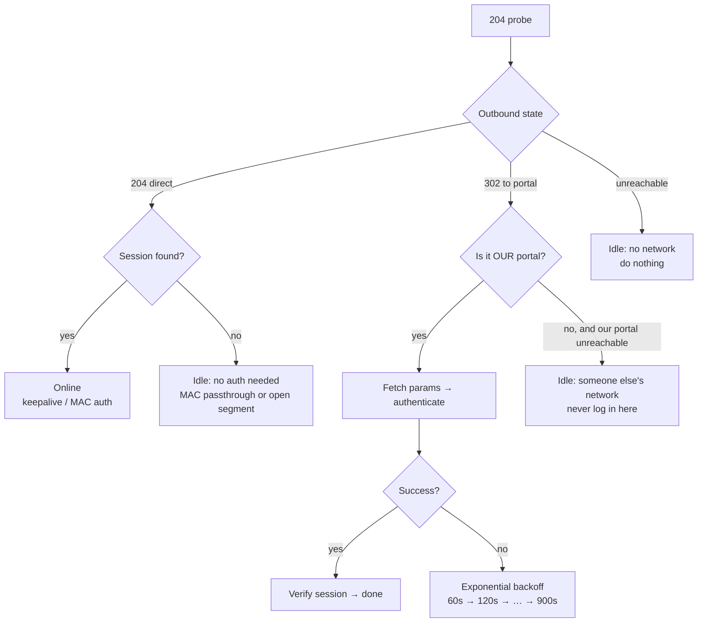

# campus-netkeeper

> Universal captive-portal auto login & session keeper for campus networks.
> Pure Python standard library · zero dependencies · zero resident process · zero hardcoding.

[中文文档](README.md)

Connects to your campus Wi-Fi and authenticates automatically. Re-authenticates
when the session drops. Runs **without a resident process** (0 MB when idle) and
is **not tied to any specific university** — the portal address and auth
parameters are discovered at runtime.

---

## Why another campus network script?

Most existing scripts hardcode one school's domain, one IP range, one SSID, and
one student ID, then run a `while True:` loop forever.

| | Typical script | campus-netkeeper |
|---|---|---|
| School binding | Hardcoded domain / IP range / SSID | **None** — discovered at runtime |
| Credentials | Written into source code | Read from `config.json` (gitignored) |
| Runtime | Resident loop, ~30 MB forever | **Scheduler-driven one-shot**, 0 MB idle |
| At home / on hotspot | May wrongly trigger login | Strict gate, completely silent |
| Adding a school | Copy-paste and edit code | Just configure; new vendor = one adapter class |
| Platforms | Usually one OS | Windows / Linux / macOS |

---

## Measured memory

Same machine, same task, two modes:

| Mode | Working set | Private bytes | Notes |
|---|---|---|---|
| `daemon` | 38.0 MB | 23.0 MB | Traditional resident process |
| `tick` | **0 MB** | **0 MB** | Process lives ~1 s then exits |

A single `tick` takes **0.99 s** wall clock: probe → query session → (login if
needed) → (keepalive if due) → exit.

Everything that must survive between runs (session index, last keepalive time,
backoff deadline, detected parameter encoding) is persisted to `state.json`.
No process does not mean no state.

---

## Supported auth systems

| Adapter | Covers | Status |
|---|---|---|
| `eportal` | **ePortal family**: Dr.COM SAM+, Ruijie, Huawei, H3C — `/eportal/InterFace.do` | ✅ Verified end-to-end on a real network (login / keepalive / MAC auth / logout) |
| `srun` | **Srun (深澜)** — `/cgi-bin/srun_portal`, one-time challenge, HMAC-MD5 + XXTEA | ⚠️ Implemented from public protocol docs; **not verified on real hardware** |

If neither matches, it falls back to `eportal` and prints diagnostics.

---

## Quick start

### Windows

```bat
init.bat          :: interactive setup (credentials + portal discovery)
install.bat       :: register scheduled task (no resident memory)
check_status.bat  :: verify
```

`install.bat` prefers a **scheduled task** (run at logon + every N minutes).
If task creation is denied, it falls back to a Startup-folder shortcut running
`daemon` mode. After installing it **triggers the task once and checks the
state file actually changed** — so "installed but silently broken" cannot
happen unnoticed.

### Linux

```sh
python3 main.py init
sh deploy/linux/install.sh     # systemd user timer, no root required
```

Falls back to `crontab` when systemd is unavailable.

### macOS

```sh
python3 main.py init
sh deploy/macos/install.sh     # LaunchAgent, no sudo required
```

### pip

```sh
pip install "git+https://github.com/baishuyue/tools-for-specific-sites.git#subdirectory=campus-netkeeper"
netkeeper init && netkeeper tick
```

---

## How it works

One gate decides whether to act at all:



All three idle branches are **read-only**. That is why the tool is completely
silent at home, on a phone hotspot, in a café, or on another university's
network.

Auth parameters (`wlanuserip`, `mac`, `nasid`, …) cannot be hardcoded because
they vary per school *and* per IP. The lookup order is:

1. **302 redirect from the captive portal** — most reliable and universal.
2. **302 from the portal root** — works once already authenticated.
3. **Local fallback** saved by `netkeeper capture`.
4. **DNS suffix heuristic** — tries `login.<school-domain>`, `portal.<...>`, etc.

---

## Commands

| Command | Purpose |
|---|---|
| `netkeeper` / `netkeeper tick` | Run one check (**default**, for schedulers) |
| `netkeeper init` | Interactive setup |
| `netkeeper doctor` | Full diagnostics, safe to paste in an issue |
| `netkeeper status` | Config summary + runtime state |
| `netkeeper login` / `logout` / `mac-register` | Manual actions |
| `netkeeper capture` | Save auth parameters as fallback |
| `netkeeper wifi` | Wireless status / connect |
| `netkeeper daemon` | Resident loop (uses ~23 MB) |

---

## Configuration

Minimum viable config:

```json
{ "username": "student-id", "password": "your-password" }
```

Other fields: `adapter` (`auto`/`eportal`/`srun`), `portal_url` (empty = auto
discover; a bare domain is accepted), `interval`, `keepalive_interval`,
`enable_mac_auth`, `campus_ip_prefixes` / `campus_ssids` (optional stricter
gating; **empty by default on purpose**), `adapter_options`.

See [README.md](README.md#配置说明) for the full table.

---

## Writing an adapter

Implement `Adapter` in `netkeeper/adapters/`, then register it in `ADAPTERS`.
Main loop, state machine, backoff and deploy scripts need no changes.

```python
class MyPortalAdapter(Adapter):
    name = "myportal"

    @classmethod
    def detect(cls, base_url, timeout=4.0) -> bool: ...
    def session(self) -> SessionInfo: ...          # return UNKNOWN on query failure
    def login(self, username, password, *, variant="") -> LoginOutcome: ...
    def keepalive(self, user_index) -> tuple[bool, str]: ...
```

---

## Technical notes

Bugs that cost real debugging time:

1. **Old appliances need `SECLEVEL=1`.** OpenSSL 3.x defaults to 2; campus ACs
   often fall below it. We degrade `2 → 1 → 0 → no-verify` and stick to the
   first working level.
2. **Two layers of `encodeURIComponent`.** Dr.COM-based portals double-encode
   `userId` / `password` / `queryString`. Not all schools do — so both variants
   are tried once and the winner is cached in `state.json`.
3. **`getOnlineUserInfo` can exceed 64 KB** (up to 276 KB observed: base64
   announcement images inline). Truncated reads break JSON parsing and get
   misread as "offline", causing a re-login storm.
4. **`result: "wait"` is not a failure.** Right after login the server may say
   `wait` while `userId` is already populated. Presence of `userId` is the real
   signal.
5. **Endpoints are not idempotent.** `registerMac` returns "already registered";
   that must be treated as success or it retries forever.
6. **Always bypass the system proxy.** Through Clash/v2ray the AC sees the
   proxy's address, not yours, and authentication fails.

---

## Security & privacy

- No telemetry, no analytics, no remote config.
- Password stored in plaintext in the local `config.json`, which is gitignored.
  Repo only contains a placeholder `config.example.json`.
- `doctor` and logs never print the password (masked only).
- Network traffic goes only to `generate_204` probe endpoints and your school's
  own portal.

---

## Known limitations

1. **Device-count limits are not bypassed** — nor should they be.
2. **"Never drops" is impossible.** Sessions live server-side; being kicked by
   another device, AC reboots, or IP changes will break them. What you get is
   automatic recovery within `interval`.
3. **First-time discovery needs one unauthenticated moment.** If you install
   while already logged in, `init` asks you to paste the portal URL.
4. **The `srun` adapter is unverified** on real hardware.
5. **Captcha / 2FA portals** cannot be fully automated; the tool reports an
   error instead of looping.
6. **802.1X (WPA-Enterprise) is out of scope** — Web Portal only.

---

## License

[MIT](LICENSE)
