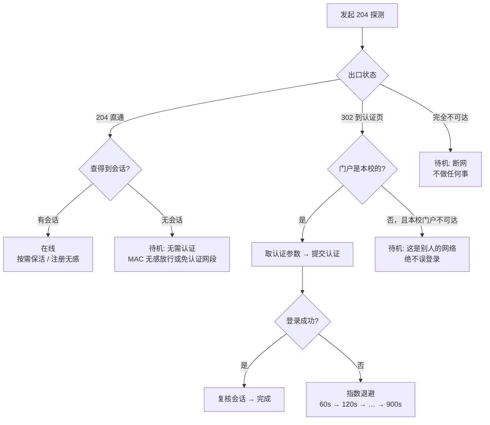

# campus-netkeeper

> 通用校园网自动认证与保活工具 · 纯 Python 标准库 · 零依赖 · 零常驻 · 零硬编码

连上校园 WiFi 就自动完成 Portal 认证，掉线后自动重连；**不需要常驻进程**
（空闲时内存占用为 0），**不绑定任何学校**（门户地址与认证参数全部运行时
探测），也不会干扰你在家、热点、公司网络下的正常使用。

```
$ netkeeper tick
open_no_session: 出口通畅，无需认证
```

---

## 目录

- [它解决什么问题](#它解决什么问题)
- [这个项目和其他方案的区别](#这个项目和其他方案的区别)
- [实测内存占用](#实测内存占用)
- [支持的认证系统](#支持的认证系统)
- [快速开始](#快速开始)
- [工作原理](#工作原理)
- [命令参考](#命令参考)
- [配置说明](#配置说明)
- [常见问题](#常见问题)
- [适配你的学校](#适配你的学校)
- [技术笔记](#技术笔记)
- [安全与隐私](#安全与隐私)
- [已知限制](#已知限制)

---

## 它解决什么问题

大学校园网几乎都是 **Web Portal 认证**：连上 WiFi 后上不了网，得先打开
浏览器，在认证页输入学号密码，点登录。麻烦在于：

- 每次开机/回宿舍都要手动登一次；
- 会话有时会莫名失效；
- 半夜掉线后没法远程连接自己的电脑。

`campus-netkeeper` 把这件事变成：**连上校园网就够了**，剩下的自动完成。

它做三件事：

1. **自动认证** —— 检测到被认证门户拦截时，自动提交账号密码。
2. **自动恢复** —— 会话失效、被踢下线、AC 重启后，在下一轮检测里自动重回。
3. **MAC 无感认证**（若学校支持）—— 登录后把本机 MAC 注册到 AC，此后
   连上就放行，连"提交密码"这一步都省了。

---

## 这个项目和其他方案的区别

| 维度 | 常见校园网脚本 | campus-netkeeper |
|---|---|---|
| 学校绑定 | 硬编码某校域名、IP 段、SSID | **无硬编码**，门户地址与参数运行时探测 |
| 账号绑定 | 账号密码写死在源码里 | 从 `config.json` 读，源码里零凭据 |
| 运行方式 | 常驻 `while True` 循环，长期占 30 MB 左右 | **默认无常驻进程**，由系统调度器周期性拉起 |
| 换校区/换网段 | 常修改 IP 段后失效 | 依靠门户可达性判断，天然跟随 |
| 在家/热点下 | 可能误触发登录 | 严格闸门，完全待机、不发任何认证请求 |
| 扩展新学校 | 复制粘贴改代码 | 配置一下即可；新厂商写一个适配器类 |
| 平台 | 通常单一系统 | Windows / Linux / macOS 都有部署脚本 |

---

## 实测内存占用

这是本项目最核心的设计取舍。同一台机器、同一个任务，两种运行模式：

| 模式 | 工作集 | 私有内存 | 说明 |
|---|---|---|---|
| `daemon` 常驻 | 38.0 MB | 23.0 MB | 传统做法，进程一直挂在后台 |
| `tick` 单次 | **0 MB** | **0 MB** | 进程存活约 1 秒后退出，静止时不占内存 |

`tick` 模式单次执行实测 **0.99 秒**，依次完成：出口探测 → 会话查询 →
（按需）登录 → （按需）保活，然后立即退出。

需要跨轮次记住的东西（会话索引、上次保活时间、退避截止时间、已探测到的
编码方式）都落盘在 `state.json` 里，所以「无进程」不等于「无状态」。

> 如果你需要掉线后**秒级**恢复，可以改用 `daemon` 模式，代价就是那 23 MB。
> 默认部署脚本装的是 `tick`。

---

## 支持的认证系统

| 适配器 | 覆盖范围 | 验证状态 |
|---|---|---|
| `eportal` | **ePortal 族**：Dr.COM（城市热点）SAM+、锐捷、华为、H3C 的 Web 认证页，接口为 `/eportal/InterFace.do` | ✅ 已在真实环境逐项验证（登录 / 保活 / MAC 无感 / 注销） |
| `srun` | **深澜 Srun**：`/cgi-bin/srun_portal`、一次性 challenge、HMAC-MD5 + XXTEA | ⚠️ 依据公开协议实现，作者无真实环境验证 |

`eportal` 是国内高校覆盖率最高的一套接口，绝大多数学校的"Dr.COM 认证"
都是它。`srun` 的加密细节（置换字母表的 Base64、XXTEA 变体）已按公开
协议文档逐字段核对，但没有真机环境，**欢迎反馈**。

两套都识别不出来时，程序会回退到 `eportal` 并给出诊断信息。

---

## 快速开始

### Windows

```bat
:: 1. 初始化（交互式填账号密码，自动发现门户）
init.bat

:: 2. 安装开机自启（计划任务，空闲不占内存）
install.bat

:: 3. 验证
check_status.bat
```

`install.bat` 会优先创建**计划任务**（登录时跑一次 + 每 2 分钟一次）；
若计划任务因权限被拒，自动退回「启动文件夹快捷方式 + daemon 常驻」。
安装完成后它会**实际触发一次任务并检查执行记录**，确认真的跑起来了
才算成功——避免"装完看着正常其实没生效"。

其他快捷入口：`doctor.bat`（诊断）、`login_now.bat`（立刻登录）、
`view_log.bat`（看日志）、`uninstall.bat`（卸载）。

### Linux

```sh
python3 main.py init          # 交互式配置
sh deploy/linux/install.sh    # systemd 用户级 timer，不需要 root
python3 main.py status        # 验证
```

没有 systemd 时自动退回 `crontab`。希望「不登录桌面也生效」的话，
再执行一次 `loginctl enable-linger $USER`。

### macOS

```sh
python3 main.py init
sh deploy/macos/install.sh    # LaunchAgent，不需要 sudo
```

### 任意平台（pip 安装）

```sh
pip install "git+https://github.com/baishuyue/tools-for-specific-sites.git#subdirectory=campus-netkeeper"
netkeeper init
netkeeper tick
```

### 手动安装自启

```sh
# Windows 计划任务里填：
pythonw "D:\path\to\main.py" tick --quiet
# Linux crontab：
*/2 * * * * cd /path/to/campus-netkeeper && python3 main.py tick --quiet
```

---

## 工作原理

### 一道闸门决定「要不要动手」

这是本项目能「在你家网络下完全静默」的关键。程序不会无条件登录，而是
先回答一个问题：**我现在是不是被困在本校的认证门户后面？**



三个待机分支都**只读不写**，不会对网络产生任何改动。所以在家里、手机
热点、咖啡厅、别的学校，它都只是静静地返回一个 "idle"。

### 认证参数从哪来

Portal 认证离不开一组加密参数（`wlanuserip`、`mac`、`nasid` …）。这些
值因校而异、因 IP 而异，硬编码必然失效。本项目的取参顺序：

1. **强制门户的 302 重定向** —— 未认证时 AC 必然把 HTTP 请求劫持到认证页，
   地址栏里就带着全部参数。这是最可靠、最通用的来源。
2. **门户首页的 302** —— 已认证时访问门户根路径会跳走，也能拿到参数。
3. **本地兜底参数** —— `netkeeper capture` 保存过的值。
4. **DNS 后缀启发式** —— 拿不到上面任何一条时，尝试 `login.<学校域名>`、
   `portal.<学校域名>` 等常见命名。

### 一次 tick 做了什么

```
读取 state.json
  ├─ 探测出口（最多 4 个 generate_204 地址）
  ├─ 判断是否在本校认证网络内      ← 不在就退出，什么都不做
  ├─ 识别认证系统类型（eportal / srun）
  ├─ 查询本机出口 IP 的会话
  │    ├─ 在线 → 按需保活、按需补注册 MAC 无感 → 退出
  │    ├─ 查询失败 → 视为"不确定"，本轮不介入 → 退出
  │    └─ 离线 → 继续
  ├─ 取认证参数 → 提交认证（自动尝试编码方式）
  └─ 写 state.json → 退出
```

---

## 命令参考

| 命令 | 作用 |
|---|---|
| `netkeeper` / `netkeeper tick` | 执行一次检测（**默认**，供调度器调用） |
| `netkeeper init` | 交互式初始化：填账号密码、自动发现门户 |
| `netkeeper doctor` | 诊断：逐项探测并输出可贴进 Issue 的信息 |
| `netkeeper status` | 查看配置摘要与运行状态 |
| `netkeeper login` | 立刻认证一次 |
| `netkeeper logout` | 主动下线 |
| `netkeeper mac-register` | 注册 MAC 无感认证 |
| `netkeeper capture` | 保存认证页参数（兜底） |
| `netkeeper wifi` | 查看无线状态 / 连接指定网络 |
| `netkeeper daemon` | 常驻循环（占内存，仅需秒级响应时用） |

`tick` 的退出码：正常情况一律返回 0（便于调度器统计）；加 `--check`
后，认证失败会返回 1。

---

## 配置说明

只填这两项就能跑：

```json
{
  "username": "你的学号",
  "password": "你的密码"
}
```

完整字段：

| 字段 | 默认 | 说明 |
|---|---|---|
| `username` / `password` | — | **必填**。校园网账号 |
| `adapter` | `"auto"` | `auto` / `eportal` / `srun` |
| `portal_url` | `""` | 认证门户地址，留空自动发现。也可只写域名（如 `login.xxx.edu.cn`），程序会自动尝试 `/eportal` |
| `campus_ip_prefixes` | `[]` | 可选。留空表示不限制；填了则要求出口 IP 命中才动作 |
| `campus_ssids` | `[]` | 可选。校园 WiFi 名称，用于自动连接与更严格判定 |
| `auto_connect_wifi` | `false` | 未连校园 WiFi 时是否自动切换 |
| `interval` | `120` | 检测间隔（秒）。Windows 安装脚本会换算成分钟 |
| `keepalive_interval` | `300` | 保活间隔（秒），`0` 表示关闭 |
| `enable_mac_auth` | `true` | 登录后是否尝试注册 MAC 无感认证 |
| `fallback_query` | `""` | 兜底认证参数，由 `capture` 命令写入 |
| `adapter_options` | `{}` | 适配器微调，如 `{"srun_type": "1"}` |

> `campus_ip_prefixes` / `campus_ssids` **默认留空是有意的**。靠"门户可达
> 且是本校门户"判断已经足够准确，而写死网段会在换校区、运营商调整后
> 静默失效——那正是老式脚本最常见的坏味道。

---

## 常见问题

**Q: 装完第一次能用，重启后失效了？**
先跑 `doctor.bat` / `netkeeper doctor`，看「门户地址」和「识别结果」两行。
若门户地址是空的，说明它从未在"未认证"状态下运行过，执行一次
`netkeeper init` 把地址固定下来即可。

**Q: 提示「已达账号同时在线的设备数上限」**
这是学校的策略，本工具**不会也不应该**绕过它。它只会保证本机不重复占用
配额、被踢后立刻回来。多台设备登录同一账号仍会互踢。

**Q: 明明登录成功了，下一轮又提示离线？**
常见于学校开启了 **MAC 无感认证**：AC 层面放行，Portal 不记录会话，所以
查不到"在线会话"。此时出口探测是 204 直通的，程序会正确进入
`open_no_session` 待机分支，不会做多余动作。

**Q: 一定要关掉 WiFi 的「随机 MAC」吗？**
如果你依赖 MAC 无感认证，**必须关**（设置 → WLAN → 你的网络 → 随机硬件
地址 → 关闭）。随机 MAC 会让 AC 每次都当成新设备，无感认证失效。

**Q: 会不会把我密码泄露出去？**
不会联网上报任何数据。密码明文存放在本地 `config.json`，且该文件已被
`.gitignore` 排除。若你在多人共用的机器上使用，请自行加密磁盘。

**Q: 安全软件报警？**
程序会调用 `schtasks`（注册计划任务）和 `powershell`（创建快捷方式），
这两个行为容易被启发式引擎标记。源码全部可见，可自行审查。

---

## 适配你的学校

### 先试配置

大部分情况**不用改代码**：

1. `netkeeper init` —— 自动完成。
2. 自动识别失败时，把认证页地址填进 `portal_url`，例如
   `https://login.你的学校.edu.cn/eportal`。
3. 仍然失败，跑 `netkeeper doctor`，把输出贴到 Issue。

### 写一个新适配器

当学校用的是第三套认证系统（不是 ePortal、也不是 Srun）时：

```python
# netkeeper/adapters/myportal.py
from ..probe import PortalTarget
from .base import Adapter, LoginOutcome, SessionInfo, SessionStatus

class MyPortalAdapter(Adapter):
    name = "myportal"
    label = "某厂商认证系统"

    @classmethod
    def detect(cls, base_url, timeout=4.0) -> bool:
        """返回 True 表示"这个门户属于我"。
        建议用一个必然存在且返回结构化数据的接口来判断，
        而不要在首页 HTML 里找关键字（很多门户的接口写在外部 JS 里）。"""
        ...

    def session(self) -> SessionInfo:
        """查询本机出口 IP 的会话。
        注意：查询失败要返回 UNKNOWN，不能返回 OFFLINE，
        否则网络一抖动就会反复重登。"""
        ...

    def login(self, username, password, *, variant="") -> LoginOutcome:
        ...

    def keepalive(self, user_index) -> tuple[bool, str]:
        ...

    def register_mac(self, mac, user_index) -> tuple[bool, str]:
        ...
```

然后在 `netkeeper/adapters/__init__.py` 的 `ADAPTERS` 字典里注册：

```python
ADAPTERS = {
    EportalAdapter.name: EportalAdapter,
    SrunAdapter.name: SrunAdapter,
    MyPortalAdapter.name: MyPortalAdapter,   # ← 加这一行
}
```

主流程、状态机、退避、部署脚本都不需要改。

### 调试技巧

```sh
netkeeper doctor          # 一眼看清卡在哪一步
export NETKEEPER_DEBUG=1  # 让异常打印完整堆栈
```

---

## 技术笔记

开发过程中踩到的坑，对后来者可能有用：

**1. 老设备要求 `SECLEVEL=1`**
不少校园 AC 的 DH 密钥长度与证书算法低于 OpenSSL 3.x 的默认安全级别
（`SECLEVEL=2`），默认配置直接报 `SSLV3_ALERT_HANDSHAKE_FAILURE`。
本项目按 `SECLEVEL 2 → 1 → 0 → 不校验证书` 逐级降级，握手成功后固定
复用该级别，不会每次都试错。

**2. 认证参数要做两次 `encodeURIComponent`**
Dr.COM 系的前端对 `userId` / `password` / `queryString` 各做了两层编码，
少一层服务端就判"用户名或密码错误"。但**不是所有学校都这样**——所以本
项目把两种编码都试一遍，把成功的那种记进 `state.json`，之后不再试错。

**3. `getOnlineUserInfo` 的响应可能超过 64 KB**
某些门户会在会话信息里内嵌 base64 公告图，响应实测达 276 KB。按 64 KB
截断读取会导致 JSON 解析失败，进而被误判成"离线"而反复重登。现在上限
是 1 MB，并且 JSON 解析失败时还有一层正则抢救逻辑。

**4. `result: "wait"` 不等于失败**
会话刚建立时服务端可能返回 `result=wait`（"用户信息不完整"），但 `userId`
已经带上了。判定在线与否要看 `userId` 是否存在，不能只看 `result`。

**5. 接口不幂等**
`registerMac` 重复调用会返回"MAC 地址已经被注册"。语义上这等价于"已经
注册好了"，必须按成功处理，否则每轮都会重复调用。

**6. 认证请求必须绕过系统代理**
走 Clash / v2ray 时，AC 看到的源地址是代理地址，认证必然失败。本项目所有
请求都用空 `ProxyHandler` 强制直连。

---

## 安全与隐私

- **不联网上报任何数据**，无遥测、无统计、无远程配置下发。
- 密码以明文存放在本地 `config.json`，该文件默认被 `.gitignore` 排除；
  仓库里只有占位的 `config.example.json`。
- `doctor` 与日志**不会**打印密码（只显示掩码）。
- 所有网络请求只发往：探测用的 `generate_204` 地址、你所在学校的认证门户。

---

## 已知限制

1. **不能绕过设备数限制**，也不应绕过。多设备同时登录同一账号仍会互踢。
2. **不能保证"永不掉线"**。会话在服务端，被更强的设备挤占、AC 重启、
   换 IP 都会打断。本项目提供的是"掉线后自动回来"，`tick` 模式下最长
   延迟 = `interval`。
3. **首次配置需要一次"未认证"状态**才能自动发现门户。若你装的时候
   恰好已经登录，`init` 会提示你手动粘贴认证页地址。
4. **`srun` 适配器未经真实环境验证**，仅有协议层核对。
5. **验证码 / 双因子认证的学校**无法完全自动，会明确报错而不是死循环重试。
6. **不处理 802.1X（WPA-Enterprise）认证**，只针对 Web Portal。

---

## 参与贡献

最需要帮助的地方是**适配新学校的认证系统**：

- 你的学校用什么系统？`netkeeper doctor` 的输出是什么？
- `srun` 适配器在真实环境下的表现如何？
- 遇到了哪一步卡住？

提 Issue 时请附上 `netkeeper doctor` 的完整输出（它不包含账号密码）。
PR 请保持：纯标准库、跨平台、不引入第三方依赖。

---

## License

[MIT](LICENSE)
